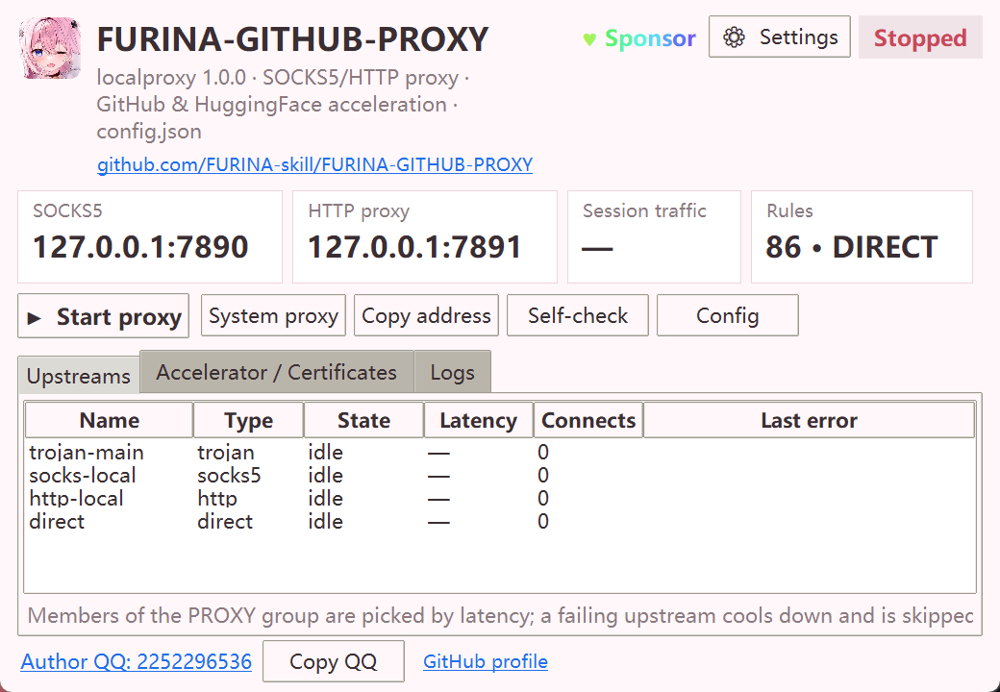
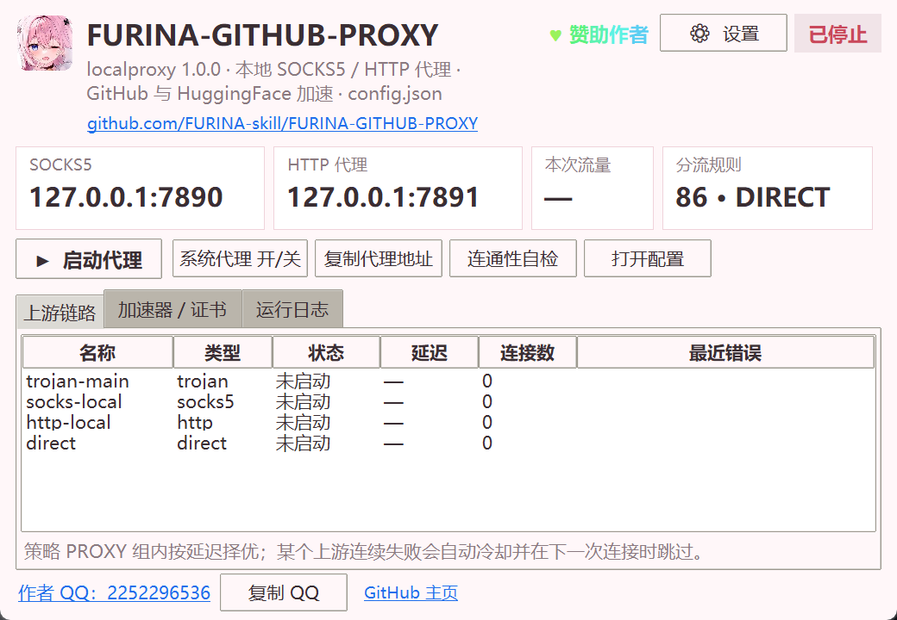

# FURINA-GITHUB-PROXY

**Local SOCKS5 / HTTP proxy with GitHub & HuggingFace acceleration — single portable EXE, no Python required.**



<details>
<summary>简体中文界面</summary>



</details>

---

## What it is / 这是什么

| | |
|---|---|
| **Local proxy** | SOCKS5 + HTTP(CONNECT) on `127.0.0.1:7890` / `127.0.0.1:7891`, metrics API on `:7892` |
| **Rule routing** | Clash-style rules (`DOMAIN-SUFFIX`, `DOMAIN-KEYWORD`, `DOMAIN-REGEX`, `IP-CIDR`, `DST-PORT`, `FINAL`) |
| **Upstreams** | `direct`, `http`, `socks5`, `trojan` (TLS) — latency-based selection, automatic failover, health checks |
| **DNS** | DoH (default) with circuit breaker + system fallback; poisoned DNS won't break direct dials |
| **Acceleration** | Local CA signs `github.com` certs, hosts → `127.0.0.1`, TLS terminated locally — or pure SNI passthrough with zero certificates |
| **UI** | Tkinter, DPI-aware, **default English**, switch to 简体中文 / 日本語 / Русский in ⚙ Settings |
| **Dependencies** | Standard library only (`cryptography` only for the CA feature), no Node, no Python at runtime |

## Install / 安装

1. Download **`FURINA-GITHUB-PROXY-Setup.exe`** from [Releases](../../releases/latest).
2. Double-click → choose options → **Install**. Per-user install, **no UAC prompt**.
3. Everything is bundled (`%LOCALAPPDATA%\Programs\FURINA-GITHUB-PROXY`), including the Python runtime.

Uninstall: *Apps & features → FURINA-GITHUB-PROXY → Uninstall*, or run the installer with `--uninstall`.

Silent install (for scripts):

```powershell
.\FURINA-GITHUB-PROXY-Setup.exe --silent --no-popup
.\FURINA-GITHUB-PROXY-Setup.exe --silent --dir D:\Apps\FURINA-GITHUB-PROXY --lang zh-CN
.\FURINA-GITHUB-PROXY-Setup.exe --silent --uninstall
```

## Quick start / 快速开始

```powershell
# GUI (double-click the exe does the same)
FURINA-GITHUB-PROXY.exe

# or CLI
FURINA-GITHUB-PROXY.exe run -c config.json
FURINA-GITHUB-PROXY.exe check -c config.json      # real TLS handshake to github.com / huggingface.co
```

Point your tools at it:

```powershell
# Windows system proxy (Edge/Chrome honour it)
FURINA-GITHUB-PROXY.exe sysproxy on

# environment
$env:HTTPS_PROXY="http://127.0.0.1:7891"; $env:HTTP_PROXY=$env:HTTPS_PROXY
# git
git config --global http.proxy http://127.0.0.1:7891
# npm / pip
npm config set proxy http://127.0.0.1:7891
```

## GitHub / HuggingFace acceleration / 加速

The traffic path: `hosts → 127.0.0.1 → this process → rule → real server`.

```powershell
FURINA-GITHUB-PROXY.exe cert init            # create local CA in .\certs
FURINA-GITHUB-PROXY.exe cert trust           # install into CurrentUser\Root (no admin)
FURINA-GITHUB-PROXY.exe accel probe github.com   # measure every resolved IP, prints the fastest
```

Set `"accelerator": {"enabled": true, "mode": "mitm", "port": 443}` in `config.json`
(`"mode": "sni"` = plain passthrough, no certificate needed), then point the domains at
yourself with an elevated PowerShell:

```powershell
powershell -ExecutionPolicy Bypass -File scripts\apply-hosts.ps1 -Apply
```

`hosts` is only safe while the proxy runs — `-Remove` (or uninstalling) restores everything.

`ip_overrides` lets you pin a working IP per domain (that is where most of the speedup comes from):

```json
"accelerator": { "ip_overrides": { "github.com": ["140.82.114.4"] } }
```

## CLI

| Command | Purpose |
|---|---|
| `run` | start listeners (SOCKS5 + HTTP + metrics) |
| `gui` | open the UI (default when double-clicked) |
| `check` | upstream probing + per-host TLS verification + loopback self test |
| `gen-config --preset dev` | write a config with GitHub/HuggingFace rule set |
| `rules --test github.com huggingface.co` | see which policy a domain hits |
| `cert init/status/export/trust/untrust/issue/leaves` | local CA management |
| `accel hosts/probe/status` | hosts snippet, IP probing, accelerator status |
| `sysproxy on/off/status` | Windows system proxy |

## Layout

```
localproxy/      proxy core: socks5, http, upstream(trojan/http/socks5), router, resolver, ca, accelerator
installer/       Setup GUI + install/uninstall logic (per-user, registry, shortcuts, CA, hosts)
assets/          app.ico (multi-size), app-256.png, about.json, i18n.json (en/zh-CN/ja/ru)
scripts/         build-exe.ps1, build-installer.ps1, apply-hosts.ps1, set-env.ps1, create-shortcut.ps1
tools/           make_icon.py (icon pipeline), probe_tls.py
tests/           49 unit + end-to-end tests (real TLS handshakes, trojan server mock, MITM/passthrough)
```

## Build from source

```powershell
python -m pip install pyinstaller cryptography
python tools\make_icon.py                  # regenerate assets/app.ico
python -m unittest discover -s tests -t .  # 49 tests
scripts\build-exe.ps1                      # -> dist\FURINA-GITHUB-PROXY.exe
scripts\build-installer.ps1                # -> dist\FURINA-GITHUB-PROXY-Setup.exe
```

## FAQ

**DoH unreachable?** `"dns": {"doh_url": "https://dns.alidns.com/dns-query"}` — the resolver trips a 120 s breaker and falls back to the system resolver automatically.

**Ports in use?** `config.json → listeners.socks5/http/api.port`.

**Certificate warning on accelerator?** Run `cert trust` (CurrentUser store, no admin) or import `certs\MyCA.cer` manually.

**Windows Defender / SmartScreen?** Unsigned build — *Properties → Unblock*, or build it yourself from source.

## Author / 作者

- GitHub: <https://github.com/FurinaNeko/FURINA-GITHUB-PROXY>
- QQ: **2252296536**

MIT License — see [LICENSE](LICENSE).
